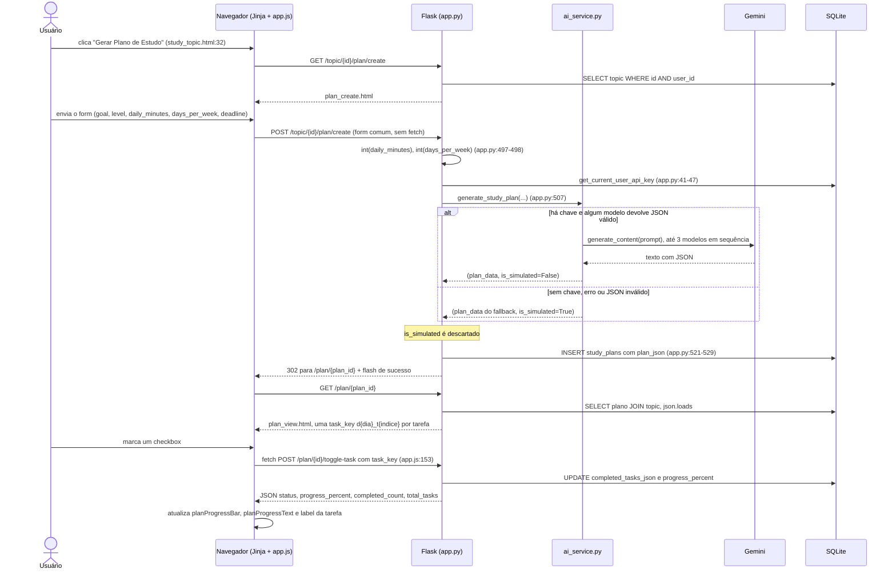
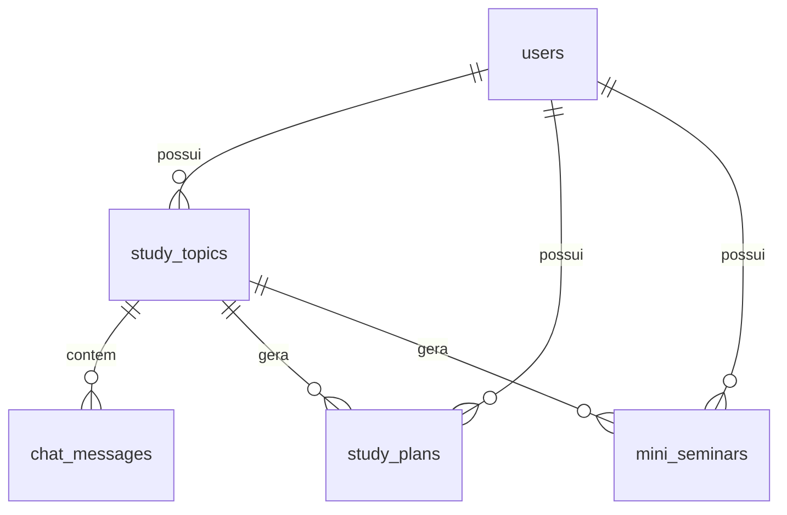

# 01 — Arquitetura

> **Referência — responsabilidade do backend.** Este arquivo descreve `app.py`, `ai_service.py`, `database.py` e `file_processor.py` para que o frontend entenda de onde vêm os dados. Não altere esses arquivos com base neste documento: problemas encontrados vão para [handoff/backend-pendencias.md](handoff/backend-pendencias.md).

## Visão em camadas

```
Navegador ── templates Jinja (HTML renderizado no servidor) + static/css/style.css + static/js/app.js
   │            forms HTML (POST → redirect)       2 × fetch() JSON (chat e checklist)
   ▼
app.py (Flask) ── rotas, sessão, @login_required, isolamento por user_id
   ├── ai_service.py ── prompts, google-genai, fallback "modo demo"
   ├── file_processor.py ── validação de extensão + extração de texto (pypdf / UTF-8)
   └── database.py ── SQLite (studyia.db), schema criado no import
```

## Fluxo principal: plano de estudos, de ponta a ponta



Durante o `POST /topic/{id}/plan/create`, o navegador fica "carregando" até a IA responder, **sem nenhum indicador visual** (ver [05-achados-frontend.md](05-achados-frontend.md)).

### Como o prompt do plano é montado (`ai_service.py:184-216`)

Uma f-string com: o papel ("planejador pedagógico do StudyIA"); os parâmetros (título, modo, objetivo, nível, minutos/dia, dias/semana, prazo); no modo arquivo, `file_text[:20000]`; um **exemplo do esquema JSON**; e a ordem "Retorne APENAS o JSON puro". A resposta passa por `clean_json_response` (`ai_service.py:5-10`), que remove a cerca ```` ```json ````, e depois por `json.loads`. **Não há validação do esquema.**

### Formato do JSON do plano (`study_plans.plan_json`)

```json
{
  "title": "Plano de Estudos — <tópico>",
  "overview": "Visão geral e metodologia",
  "total_days": 5,
  "daily_minutes": 30,
  "days": [
    { "day_number": 1, "topic": "Tema do dia", "tasks": ["Tarefa 1", "Tarefa 2"], "estimated_minutes": 30 }
  ]
}
```

O `plan_view.html` usa `title`, `overview` e `days[].day_number/topic/tasks/estimated_minutes`. Os campos `total_days` e `daily_minutes` do JSON **não são usados**: a tela exibe `plan.daily_minutes` e `plan.days_per_week`, que vêm das colunas do banco.

O **fallback** (`ai_service.py:232-263`) gera de 3 a 7 dias (`days_per_week`, limitado a esse intervalo), com 5 estágios fixos em rodízio e 2 tarefas por dia, já com os minutos no texto (60% e 40%).

## Fluxos resumidos

### Novo assunto: `POST /topic/new-subject` (`app.py:199-247`)
1. O form do dashboard envia `title` e `initial_question`.
2. O app cria `study_topics` (`topic_type='subject'`). Se houver `initial_question`, ela é salva como mensagem `user`.
3. `generate_topic_overview` (`ai_service.py:23-85`) devolve **Markdown** com seções fixas (definição, pilares, aplicações, trilhas e, se houver, a resposta à dúvida inicial).
4. A resposta é salva como mensagem `assistant`, e o app redireciona para `/topic/<id>` com flash.

### Chat: `POST /topic/<id>/message` via fetch (`app.py:412-474`)
1. O `app.js` envia `{"message": "..."}` em JSON.
2. O app salva a pergunta e lê todo o histórico do tópico (`app.py:441-444`).
3. `ask_assistant` (`ai_service.py:88-174`) monta um **texto único** com a instrução de sistema e as últimas 20 mensagens no formato `[user]: ...` / `[model]: ...`, mais a pergunta. No modo arquivo, a instrução inclui `file_text[:30000]` e a regra "Esta informação não consta no material anexado".
4. O app salva a resposta, atualiza `study_topics.updated_at` e devolve `{"reply": "...", "is_simulated": bool}`.
5. O `app.js` desenha a bolha e renderiza o Markdown com `marked`.

Fallback do chat (`ai_service.py:146-174`): no modo arquivo, se nenhuma palavra de 4 letras ou mais da pergunta aparecer no texto do arquivo, ele responde "não consta no material anexado". Senão, devolve um trecho dos primeiros 400 caracteres. No modo assunto, devolve um texto fixo.

### Upload de arquivo: `POST /topic/upload-file` (`app.py:286-344`)
1. O form multipart envia `document` e `custom_title`. O limite é 10 MB (`app.py:26`).
2. `allowed_file` aceita apenas `pdf`, `txt` e `md` (`file_processor.py:4-7`).
3. O arquivo é salvo como `uploads/user{id}_{AAAAMMDD_HHMMSS}_{nome}`.
4. `extract_text_from_file` (`file_processor.py:9-44`): no PDF, junta as páginas com o marcador `--- Página N ---`; no TXT/MD, lê em UTF-8. Se der erro (PDF de imagem, arquivo vazio), **apaga o arquivo** e mostra um flash `danger`.
5. O app cria `study_topics` (`topic_type='file'`, com `extracted_text`) e uma mensagem de boas-vindas **fixa**, sem chamar a IA, e redireciona para `/topic/<id>`.

### Mini seminário (`app.py:624-755`)
1. `POST /topic/<id>/seminar/create` (sem campos) chama `generate_mini_seminar` (`ai_service.py:266-360`). O prompt pede 4 perguntas; o fallback gera 3.
2. O JSON é salvo em `mini_seminars.questions_json`, e o app redireciona para `/seminar/<id>`.
3. O form envia `q_<id>` para cada questão. `submit_seminar` chama `evaluate_mini_seminar` (`ai_service.py:363-474`) e grava `user_answers_json`, `feedback_json`, `score` e `is_completed=1`.
4. Redireciona para `/seminar/<id>`, que agora mostra o resultado.

Formatos:

```json
// questions_json
{ "title": "...", "instructions": "...",
  "questions": [
    { "id": 1, "type": "multiple_choice", "question": "...", "options": ["A) ...", "B) ..."],
      "correct_answer": "A) ...", "explanation": "..." },
    { "id": 2, "type": "essay", "question": "...", "key_points": ["..."] }
  ] }

// feedback_json
{ "score": 85, "summary": "...",
  "feedback_items": [ { "question_id": 1, "status": "correct | partial | incorrect", "feedback": "..." } ],
  "strengths": ["..."], "topics_to_review": ["..."] }
```

A correção no fallback (`ai_service.py:414-474`) compara os **2 primeiros caracteres** da alternativa escolhida com a correta. Nas discursivas, olha só o tamanho: mais de 25 caracteres vale 0,85; mais de 5 vale 0,5.

## Chave do Gemini: ordem de resolução

Desde a [feature 01](features/01-remover-configurar-ia.md), a chave vem **só** do ambiente. `get_current_user_api_key()` (`app.py:45-48`) e depois `get_gemini_client()` (`ai_service.py:12-21`):

1. Usa a variável de ambiente `GEMINI_API_KEY` (`.env` ou variável do servidor).
2. Se estiver vazia, o cliente vale `None` e o app usa o **fallback**.

- A coluna `users.gemini_api_key` **não é mais lida nem gravada**. O `init_db()` limpa as chaves que tinham sido salvas pela interface antiga; a coluna sai num PR futuro de banco.
- O modo demonstração efetivo é exposto a todos os templates como `ai_demo_mode` (`context_processor` `inject_ai_mode`, `app.py:50-53`), e o servidor registra um `WARNING` no log ao iniciar sem `GEMINI_API_KEY`.
- Limite conhecido: `ai_demo_mode` só detecta a **ausência** da chave. Chave inválida, modelo inexistente ou rede fora continuam caindo no demo sem banner (ver a tabela abaixo).

## Quando o app cai no fallback (modo demo)

| Situação | Onde | Aviso |
|---|---|---|
| Nenhuma chave disponível | `ai_service.py:13-15` | banner "Modo demonstração" no dashboard + `WARNING` no log ao iniciar |
| Erro ao importar `google.genai` ou criar o cliente | `ai_service.py:16-21` | `print` no console |
| Os 3 modelos (`gemini-3.5-flash-lite`, `gemini-3.5-flash`, `gemini-3.8-flash`) lançam exceção | `ai_service.py:57`, `:131`, `:219`, `:305`, `:402` | `print` no console |
| A resposta não é JSON válido (plano, seminário, avaliação) | `json.loads` dentro do `try` | `print` no console |

Em todos esses casos a queda é **silenciosa** para o usuário. ⚠️ não confirmado: se os nomes de modelo acima existem para a chave usada. Se não existirem, o app roda sempre em demo.

## Schema do banco (`database.py:13-98`)

| Tabela | Colunas | Relações |
|---|---|---|
| `users` (`:18-28`) | `id` PK, `name`, `username` UNIQUE, `email` UNIQUE, `password_hash` (werkzeug), `gemini_api_key` DEFAULT `''` (sem uso desde a feature 01; sai num PR de banco), `created_at` | — |
| `study_topics` (`:31-44`) | `id`, `user_id`, `title`, `topic_type` CHECK(`'subject'`,`'file'`), `file_name`, `file_path`, `extracted_text`, `created_at`, `updated_at` | `user_id` → `users` ON DELETE CASCADE |
| `chat_messages` (`:47-56`) | `id`, `topic_id`, `sender` CHECK(`'user'`,`'assistant'`), `content`, `created_at` | `topic_id` → `study_topics` CASCADE |
| `study_plans` (`:59-77`) | `id`, `topic_id`, `user_id`, `goal`, `level`, `daily_minutes`, `days_per_week`, `deadline`, `plan_json`, `completed_tasks_json` DEFAULT `'[]'`, `progress_percent`, `created_at`, `updated_at` | `topic_id` → `study_topics` CASCADE; `user_id` → `users` CASCADE |
| `mini_seminars` (`:80-95`) | `id`, `topic_id`, `user_id`, `title`, `questions_json`, `user_answers_json`, `feedback_json`, `score`, `is_completed` (0/1), `created_at` | `topic_id` → `study_topics` CASCADE; `user_id` → `users` CASCADE |



O que importa para o frontend:
- Os timestamps são `CURRENT_TIMESTAMP` em **UTC** e chegam ao Jinja como **string** (`sqlite3.Row`). Os templates fatiam essas strings (ver [04-contratos-frontend.md §7.4](04-contratos-frontend.md#74-lógica-embutida-nos-templates)).
- O isolamento por usuário é feito com `AND user_id = ?` em toda consulta de leitura.
- Excluir um tópico (`app.py:346-370`) apaga em cascata as mensagens, os planos e os seminários, além do arquivo em disco.
