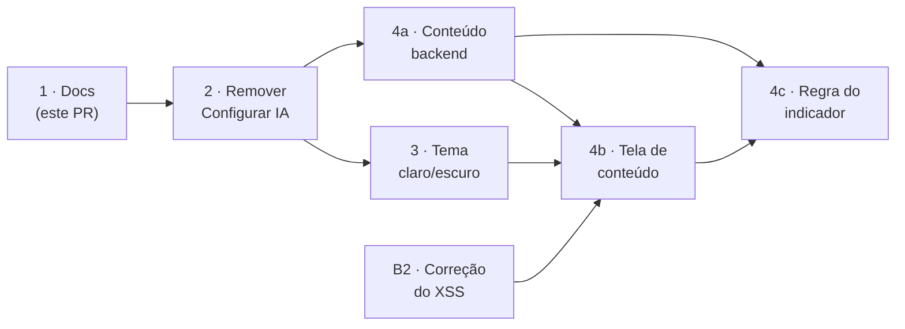

# Funcionalidades — especificação

Especificação das próximas 3 funcionalidades do StudyIA, **antes** da implementação. Cada documento separa o que o grupo já decidiu do que ainda é proposta, e aponta o código atual com `arquivo:linha`.

> Base: commit `69c99ab` (branch `main`, depois do merge da sprint 01). As referências `arquivo:linha` valem para esse commit e foram **conferidas no código**, não só nos docs. Os docs `01` a `05` citam o commit `7fbd035`; algumas linhas mudaram desde então (por exemplo, `#openSettingsBtn` estava em `base.html:26` e hoje está em `base.html:56`).
>
> Esta pasta é **só documentação**. Nenhum arquivo de código foi alterado.

## Arquivos

| # | Documento | Tamanho | Quem lidera |
|---|---|---|---|
| 01 | [Remover "Configurar IA"](01-remover-configurar-ia.md) | pequeno (1 PR) | quem estiver mexendo (toca backend e frontend) |
| 02 | [Tema claro / escuro / dispositivo](02-tema-claro-escuro-dispositivo.md) | médio (1 PR) | frontend (Renzo); não toca o backend |
| 03 | [Conteúdo dentro do plano](03-conteudo-do-plano.md) | grande (3 PRs) | **equipe de backend** |

## Legenda

| Marcador | Significado |
|---|---|
| ✅ **Decidido** | Combinado pelo grupo. Não é para rediscutir na implementação. |
| 💡 **Proposta — validar com a equipe** | Sugestão técnica de quem escreveu o doc. A equipe pode trocar. |
| ❓ **Em aberto** | Ninguém decidiu ainda. Precisa de decisão antes do PR que depende dela. |
| ⚠️ **Não confirmado** | Conclusão tirada da leitura do código, sem rodar o app. |
| **A / B / C** | Escopos do [índice dos docs](../README.md#legenda-de-escopo): A visual, B comportamento do frontend (template/JS), C backend. |

Cada documento segue a mesma estrutura: objetivo · como funciona hoje · como deve funcionar · decisões do grupo · proposta técnica · impacto por camada · contratos afetados · riscos · critérios de aceite · divisão em PRs · em aberto.

## Ordem de implementação ✅ Decidido

| Passo | PR | Por que nesta posição |
|---|---|---|
| 1 | **Este PR de documentação** | Alinha o grupo antes de qualquer código, principalmente na funcionalidade 3, que mexe em banco, IA, rotas e frontend ao mesmo tempo. Os PRs seguintes apontam para estes docs. |
| 2 | **Remover "Configurar IA"** ([01](01-remover-configurar-ia.md)) | É a menor e destrava as outras duas: libera o espaço da navbar para o seletor de tema e tira do caminho o modal, que teria de ganhar versão escura à toa. Também corrige o banner de demonstração, que sem o modal ficaria errado para sempre. |
| 3 | **Tema claro/escuro/dispositivo** ([02](02-tema-claro-escuro-dispositivo.md)) | Vem antes do conteúdo para que a tela nova de conteúdo (4b) já nasça usando só tokens e funcionando nos dois temas, sem retrabalho. Depende do passo 2 por causa do espaço na navbar. |
| 4a | **Conteúdo — backend** ([03 §PR 4a](03-conteudo-do-plano.md#pr-4a--backend)) | Tabela, rotas, IA, regra de conclusão no servidor e testes. Não depende do tema; pode começar em paralelo com o passo 3, mas só entra na `main` depois do passo 2 (as duas mexem no `app.py`). |
| 4b | **Conteúdo — tela** ([03 §PR 4b](03-conteudo-do-plano.md#pr-4b--tela-de-conteúdo)) | Precisa das rotas do 4a e dos tokens escuros do passo 3. Tem como **pré-requisito a correção do XSS (B2)**, porque o conteúdo gerado é renderizado como Markdown. |
| 4c | **Conteúdo — regra do indicador** ([03 §PR 4c](03-conteudo-do-plano.md#pr-4c--regra-do-indicador-de-conclusão)) | Fecha a funcionalidade: o checkbox vira indicador, o `toggle-task` sai e o fetch do checklist no `app.js` muda. Por último porque é o passo que quebra contratos antigos (docs/04 §7.2) e só faz sentido com a tela de conteúdo pronta. |

Leitura do diagrama: uma seta significa "precisa estar na `main` antes". O B2 (XSS, [05-achados-frontend.md](../05-achados-frontend.md), §B2) não é uma das 3 funcionalidades, mas vira pré-requisito do 4b.

## Itens de docs existentes que estas funcionalidades tocam

| Doc existente | Item | Funcionalidade |
|---|---|---|
| [handoff/backend-pendencias.md](../handoff/backend-pendencias.md) | §2 chave em texto puro, §7 fallback silencioso, §9 banner de demo | 01 |
| [handoff/backend-pendencias.md](../handoff/backend-pendencias.md) | §8 `is_simulated` descartado, §11 JSON da IA sem validação, §12 CSRF, §15 emojis no conteúdo gerado | 03 |
| [05-achados-frontend.md](../05-achados-frontend.md) | B5 (modal sem acessibilidade) deixa de existir | 01 |
| [05-achados-frontend.md](../05-achados-frontend.md) | B11 (cores inline do `app.js`) | 02 |
| [05-achados-frontend.md](../05-achados-frontend.md) | B2 (XSS), B3 (`response.ok`), B4 (carregamento e clique duplo) | 03 |
| [04-contratos-frontend.md](../04-contratos-frontend.md) | não é alterado por este PR; cada doc lista o que muda em "Contratos afetados", e o PR de implementação atualiza o 04 | 01, 02, 03 |
